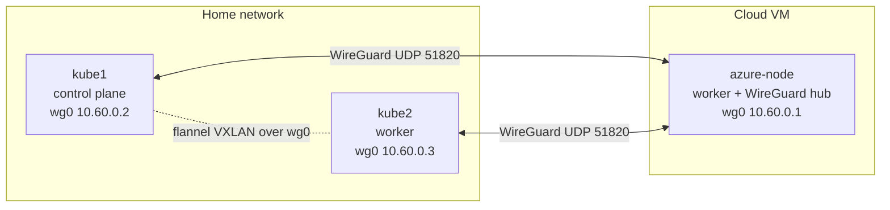
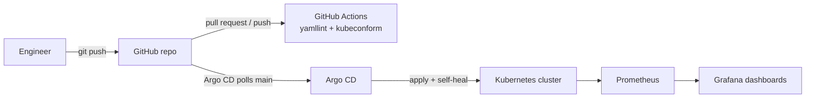
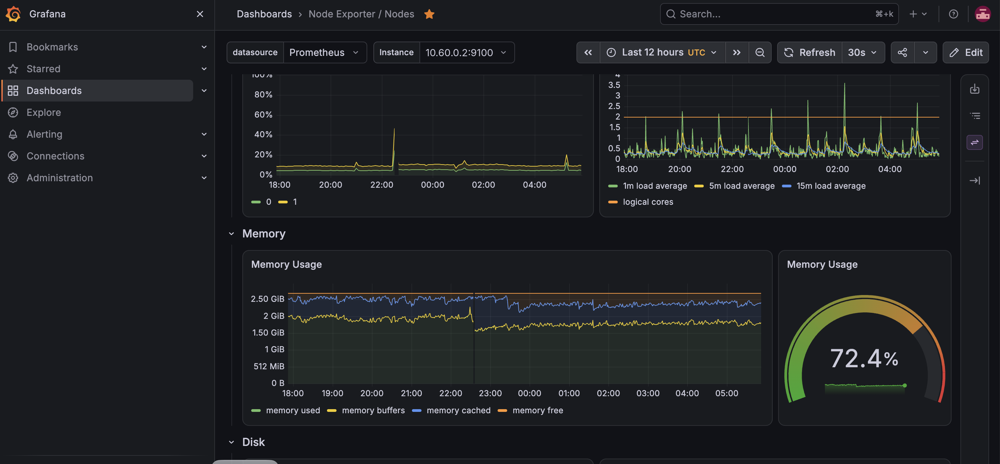
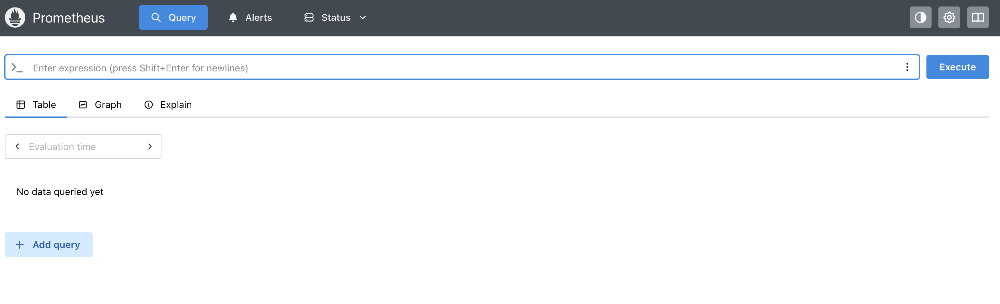

# Grafana-ArgoCD: a three-node Kubernetes lab with GitOps and monitoring

A hands-on build of a small, production-style Kubernetes platform across a home network and a cloud VM:

- **Kubernetes** (k3s) on three machines: two at home, one in the cloud
- **WireGuard** hub-and-spoke tunnel joining all three into one private network
- **Argo CD** for GitOps: Git is the source of truth, the cluster follows it
- **Prometheus and Grafana** (kube-prometheus-stack) installed *by* Argo CD
- **GitHub Actions** as the CI stage that validates every change before Argo CD deploys it
- A runbook of every step, every command, and every problem hit along the way

**Live page (GitHub Pages):** https://mahesant.github.io/Grafana-ArgoCD/
**Step-by-step runbook:** [docs/RUNBOOK.md](docs/RUNBOOK.md)
**PromQL queries used:** [docs/QUERIES.md](docs/QUERIES.md)

## Architecture



Addresses below are example values for the private tunnel network.

| Node | Role | Overlay address |
|---|---|---|
| kube1 | k3s server (control plane), Argo CD, admin shell | 10.60.0.2 |
| kube2 | k3s agent | 10.60.0.3 |
| azure-node | k3s agent, WireGuard hub, runs Prometheus and Grafana | 10.60.0.1 |

The nodes have only about 3 GB of memory each, so Prometheus and Grafana are pinned to the node with spare memory using a `nodeSelector`.

## The GitOps and CI/CD flow



- **CI:** [.github/workflows/validate.yml](.github/workflows/validate.yml) lints the YAML and checks it against Kubernetes schemas on every push and pull request.
- **CD:** Argo CD watches the `main` branch. A merged change is applied automatically (`automated` sync), anything removed from Git is deleted (`prune`), and any manual drift is reverted (`selfHeal`).

## Screenshots

Grafana, using the Node Exporter / Nodes dashboard against the cluster's Prometheus:



Prometheus query UI (NodePort 30900):



## Repository layout

```
.
├── README.md
├── docs/
│   ├── index.html        # public web page (GitHub Pages)
│   ├── RUNBOOK.md        # step-by-step build guide
│   ├── QUERIES.md        # PromQL used in Grafana and Prometheus
│   └── images/           # screenshots with personal details removed
├── manifests/
│   ├── argocd/           # Argo CD Application definitions
│   ├── apps/podinfo/     # demo application
│   └── monitoring/       # PrometheusRule alert rules
├── configs/              # k3s and WireGuard config templates (no secrets)
└── .github/workflows/    # CI checks
```

## Quick start

Read the [runbook](docs/RUNBOOK.md) from the top. The short version:

1. Build the WireGuard tunnel between the machines.
2. Install k3s on one node, join the others, with `flannel-iface: wg0` on every node.
3. Install Argo CD.
4. Apply `manifests/argocd/monitoring-app.yaml` (after replacing the two placeholders) and let Argo CD install Prometheus and Grafana.
5. Open Grafana on port 30300 and run the queries in [docs/QUERIES.md](docs/QUERIES.md).

## Ports used in the lab

| Service | NodePort |
|---|---|
| Grafana | 30300 |
| Prometheus | 30900 |
| Argo CD (HTTPS) | 30398 |
| podinfo demo app | 30998 |

## Security notes

This is a learning lab. Passwords, tokens, WireGuard keys and kubeconfig files are **not** in this repository and must never be committed. Replace every `CHANGE_ME` placeholder with your own value, and prefer a Kubernetes Secret or a secrets manager for anything real. NodePorts are reachable only over the private network in this design.

## What this does not include

The demo application (podinfo) is deployed by Argo CD but is not yet scraped by Prometheus. A ServiceMonitor for it is a natural next step.
