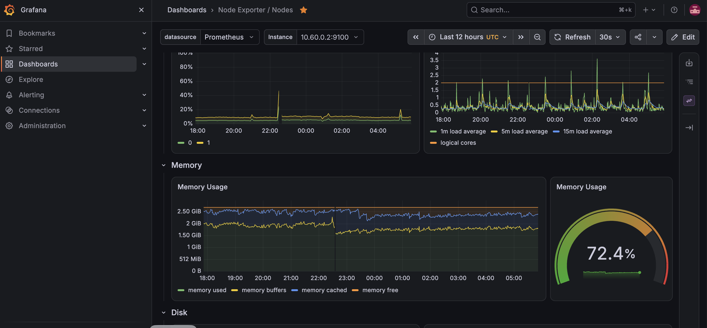
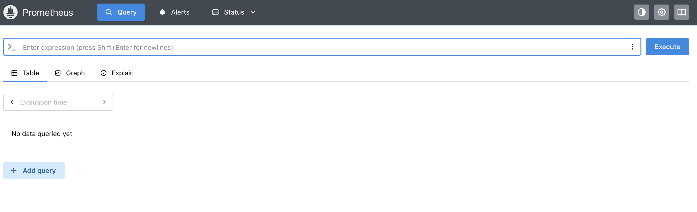

# PromQL queries

All of these were run against the lab cluster, in **Grafana Explore** (Code mode) or the **Prometheus UI** at `http://<node>:30900`. They rely on three exporters installed by kube-prometheus-stack: `node-exporter` (host metrics), `kube-state-metrics` (Kubernetes object state) and the kubelet's cAdvisor endpoint (container usage).

## How to run a query in Grafana

1. Open Grafana and log in.
2. Click **Explore** in the left menu.
3. Choose the **Prometheus** data source.
4. Switch to **Code** mode and paste the query.
5. Press **Shift+Enter** (Run query). Use the **Table** view for current values.



## 1. Is everything being scraped?

```promql
count by (job) (up)
up == 0
```
The first returns one line per scrape job. The second should return nothing; any result is a target that is down.

## 2. Nodes

```promql
# Node is Ready
kube_node_status_condition{condition="Ready",status="true"}

# Memory used, percent
100 * (1 - node_memory_MemAvailable_bytes / node_memory_MemTotal_bytes)

# CPU used, percent
100 * (1 - avg by (instance) (rate(node_cpu_seconds_total{mode="idle"}[5m])))

# Root filesystem used, percent
100 * (1 - node_filesystem_avail_bytes{mountpoint="/",fstype!~"tmpfs|overlay"}
         / node_filesystem_size_bytes{mountpoint="/",fstype!~"tmpfs|overlay"})

# Load average (1 minute)
node_load1

# WireGuard tunnel traffic
rate(node_network_receive_bytes_total{device="wg0"}[5m])
rate(node_network_transmit_bytes_total{device="wg0"}[5m])
```

## 3. Node uptime

```promql
# seconds since boot
time() - node_boot_time_seconds

# days since boot
(time() - node_boot_time_seconds) / 86400
```

## 4. Busiest nodes

```promql
topk(3, 100 * (1 - node_memory_MemAvailable_bytes / node_memory_MemTotal_bytes))
topk(3, 100 * (1 - avg by (instance) (rate(node_cpu_seconds_total{mode="idle"}[5m]))))
```
On the command line, `kubectl top nodes` gives the same view using metrics-server.

## 5. Error rate per node

```promql
# Network errors per second
sum by (instance) (rate(node_network_receive_errs_total[5m]) + rate(node_network_transmit_errs_total[5m]))

# Dropped packets per second
sum by (instance) (rate(node_network_receive_drop_total[5m]) + rate(node_network_transmit_drop_total[5m]))

# Error ratio (better for alerting: it scales with traffic)
sum by (instance) (rate(node_network_receive_errs_total[5m]))
  / sum by (instance) (rate(node_network_receive_packets_total[5m]))

# Kubelet operation errors
sum by (instance) (rate(kubelet_runtime_operations_errors_total[5m]))

# Container restarts per node, last hour
sum by (node) (increase(kube_pod_container_status_restarts_total[1h])
  * on (namespace, pod) group_left(node) kube_pod_info)
```

### How `rate()` reads

`rate(node_network_receive_errs_total[5m])`

- `node_network_receive_errs_total` is a **counter**: a running total since boot that only goes up.
- `[5m]` is a **range selector**: take every sample from the last 5 minutes.
- `rate()` turns those samples into an average **per-second increase**, and handles counter resets after a reboot.

If the counter was 100 five minutes ago and is 130 now, `rate()` returns 0.1 errors per second. Use `rate()` on counters only; gauges such as `node_load1` are used as they are.

## 6. Pods and workloads

```promql
# Pods by phase
sum by (phase) (kube_pod_status_phase)

# Pods that are not healthy
kube_pod_status_phase{phase=~"Pending|Failed|Unknown"} == 1

# Containers that restarted in the last hour
increase(kube_pod_container_status_restarts_total[1h]) > 0

# Containers whose last exit was an out-of-memory kill
kube_pod_container_status_last_terminated_reason{reason="OOMKilled"} == 1

# Deployments with fewer ready replicas than wanted
kube_deployment_spec_replicas != kube_deployment_status_replicas_available

# Pods per node
count by (node) (kube_pod_info)
```

## 7. Container usage

```promql
# Top 5 pods by memory
topk(5, sum by (namespace, pod) (container_memory_working_set_bytes{container!=""}))

# Top 5 pods by CPU
topk(5, sum by (namespace, pod) (rate(container_cpu_usage_seconds_total{container!=""}[5m])))

# Memory by namespace
sum by (namespace) (container_memory_working_set_bytes{container!=""})

# Memory used as a fraction of the limit (near 1 means an OOM kill is close)
container_memory_working_set_bytes{container!=""}
  / on (namespace, pod, container) kube_pod_container_resource_limits{resource="memory"}
```

## 8. API server and Prometheus itself

```promql
sum by (code) (rate(apiserver_request_total[5m]))
histogram_quantile(0.99, sum by (le, verb) (rate(apiserver_request_duration_seconds_bucket{verb!~"WATCH|CONNECT"}[5m])))
prometheus_tsdb_head_series
rate(prometheus_tsdb_head_samples_appended_total[5m])
```
The API server queries may return nothing on k3s, depending on how that target is exposed.

## 9. Alert rules

See [manifests/monitoring/lab-rules.yaml](../manifests/monitoring/lab-rules.yaml). After applying it, check `/rules` and `/alerts` in the Prometheus UI.


