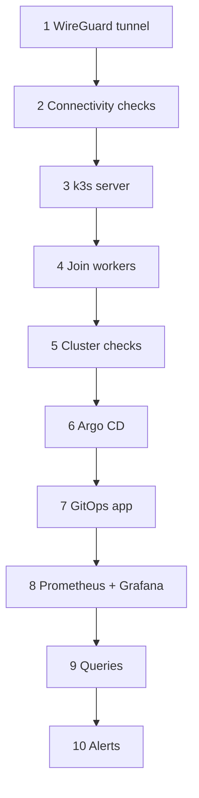
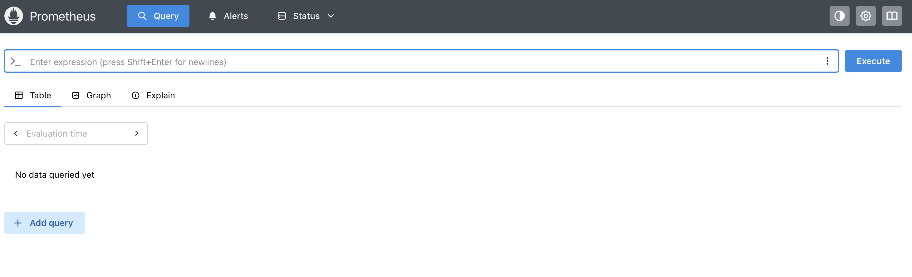
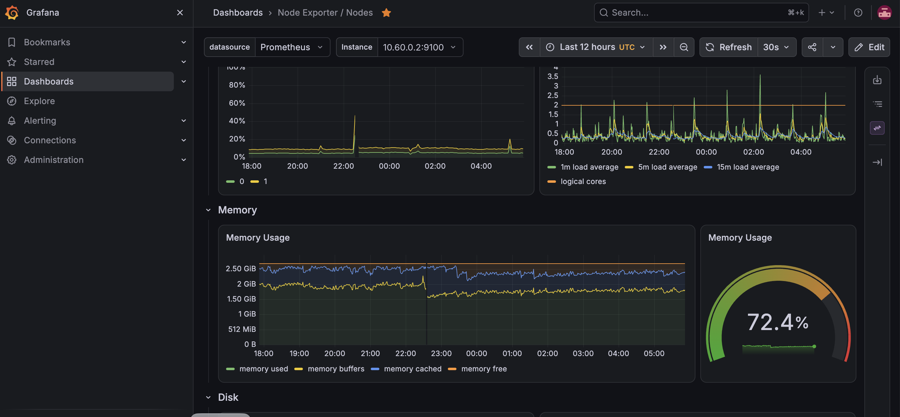

# Runbook: building the lab step by step

This is the order the lab was built in, with the commands and the checks after each step. Do the checks. Every problem we hit was caught by a check that was skipped or by an assumption that turned out wrong; those are collected in [section 12](#12-problems-we-hit-and-how-they-were-fixed).

Placeholders: `kube1` is the control-plane machine, `kube2` the second home machine, `azure-node` the cloud VM. Replace addresses and names with your own.

## Contents

0. [What you need](#0-what-you-need)
1. [Network: WireGuard hub and spoke](#1-network-wireguard-hub-and-spoke)
2. [Check connectivity](#2-check-connectivity)
3. [Install k3s on the control plane](#3-install-k3s-on-the-control-plane)
4. [Join the workers](#4-join-the-workers)
5. [Check the cluster and the overlay network](#5-check-the-cluster-and-the-overlay-network)
6. [Install Argo CD](#6-install-argo-cd)
7. [GitOps: first application and the change flow](#7-gitops-first-application-and-the-change-flow)
8. [Prometheus and Grafana through Argo CD](#8-prometheus-and-grafana-through-argo-cd)
9. [Look at the data](#9-look-at-the-data)
10. [Alert rules](#10-alert-rules)
11. [CI with GitHub Actions, and secrets](#11-ci-with-github-actions-and-secrets)
12. [Problems we hit and how they were fixed](#12-problems-we-hit-and-how-they-were-fixed)
13. [Clean-up](#13-clean-up)

---

## 0. What you need

- Three Linux machines: two at home (RHEL in this build) and one cloud VM (Ubuntu), each with 2 vCPU and about 3 GB of memory or more.
- A user with `sudo` on each machine and SSH access between them.
- A GitHub account and a repository for the manifests (this one).
- A browser on the same network as the nodes.



## 1. Network: WireGuard hub and spoke

The home machines sit behind a router and cannot accept inbound connections, so the cloud VM is the hub with a public address. Each home machine connects out to it. The hub forwards traffic between the spokes, so all three machines can reach each other on `10.60.0.0/24`.

| Machine | WireGuard address |
|---|---|
| azure-node (hub) | 10.60.0.1 |
| kube1 | 10.60.0.2 |
| kube2 | 10.60.0.3 |

**1.1 Install WireGuard** on all three machines.

```bash
# RHEL
sudo dnf install -y wireguard-tools
# Ubuntu
sudo apt update && sudo apt install -y wireguard
```

**1.2 Create a key pair** on each machine. Keep the private key private.

```bash
umask 077
wg genkey | sudo tee /etc/wireguard/privatekey | wg pubkey | sudo tee /etc/wireguard/publickey
```

**1.3 Configure the hub.** Use [configs/wireguard-hub-wg0.conf](../configs/wireguard-hub-wg0.conf) as a template. Turn on forwarding and open **UDP 51820** in the cloud network security group.

```bash
echo 'net.ipv4.ip_forward=1' | sudo tee /etc/sysctl.d/99-forward.conf && sudo sysctl --system
```

**1.4 Configure each spoke** with [configs/wireguard-spoke-wg0.conf](../configs/wireguard-spoke-wg0.conf). The `PersistentKeepalive = 25` line keeps the home router's NAT mapping open.

**1.5 Start the tunnel** on all three.

```bash
sudo systemctl enable --now wg-quick@wg0
sudo wg show
```

On RHEL, put `wg0` in a trusted firewall zone so cluster traffic is not blocked:

```bash
sudo firewall-cmd --permanent --zone=trusted --add-interface=wg0 && sudo firewall-cmd --reload
```

## 2. Check connectivity

From **each** machine, ping the other two overlay addresses.

```bash
ping -c 3 10.60.0.1
ping -c 3 10.60.0.2
ping -c 3 10.60.0.3
```

`sudo wg show` should list a recent handshake for each peer. Do not continue until all nine paths work. Also confirm SSH between the machines, with key-based login and passwordless `sudo` for your admin user.

## 3. Install k3s on the control plane

k3s is a small, single-binary Kubernetes. The important setting is `flannel-iface: wg0`, which sends pod traffic through the WireGuard tunnel (see problem 3 in section 12).

**3.1 Create the config before installing.** Use [configs/k3s-server-config.yaml](../configs/k3s-server-config.yaml):

```bash
sudo mkdir -p /etc/rancher/k3s
sudo cp configs/k3s-server-config.yaml /etc/rancher/k3s/config.yaml
```

**3.2 Install.**

```bash
curl -sfL https://get.k3s.io | sudo sh -s - server
sudo systemctl status k3s --no-pager
```

**3.3 Check the node and set up kubectl.** Without a kubeconfig, `kubectl` says `localhost:8080 connection refused`.

```bash
mkdir -p ~/.kube
sudo cp /etc/rancher/k3s/k3s.yaml ~/.kube/config
sudo chown $USER ~/.kube/config
kubectl get nodes
```

**3.4 Get the join token** for the workers.

```bash
sudo cat /var/lib/rancher/k3s/server/node-token
```

## 4. Join the workers

On **kube2** and on **azure-node**, create `/etc/rancher/k3s/config.yaml` from [configs/k3s-agent-config.yaml](../configs/k3s-agent-config.yaml). Set `node-ip` to that machine's own WireGuard address and paste the token. Then:

```bash
curl -sfL https://get.k3s.io | sudo sh -s - agent
sudo systemctl status k3s-agent --no-pager
```

Back on kube1:

```bash
kubectl get nodes -o wide
```

All three nodes should be `Ready`, and `INTERNAL-IP` should be the `10.60.0.x` address for each one.

**Running `kubectl` on a worker (optional).** Copy the kubeconfig and point it at the control plane's overlay address:

```bash
# on a worker
mkdir -p ~/.kube
ssh kube1 'sudo cat /etc/rancher/k3s/k3s.yaml' | sed 's/127.0.0.1/10.60.0.2/' > ~/.kube/config
kubectl get nodes
```

## 5. Check the cluster and the overlay network

Create a test workload and call it through a NodePort on every node. A NodePort opens the same port on all nodes and forwards to the pods wherever they run, so this tests pod networking across the tunnel.

```bash
kubectl create deployment web --image=nginx --replicas=3
kubectl expose deployment web --type=NodePort --port=80
kubectl get svc web          # note the node port, for example 31234
kubectl get pods -o wide     # pods should be spread across nodes
for ip in 10.60.0.1 10.60.0.2 10.60.0.3; do
  curl -s -o /dev/null -w "$ip %{http_code}\n" http://$ip:31234
done
```

All three must print `200`, every time. Run the loop several times; an occasional `000` means some pod-to-node path is broken (problem 3). Clean up afterwards:

```bash
kubectl delete deployment web && kubectl delete svc web
```

### Service ports at a glance

| Name | Meaning |
|---|---|
| `containerPort` / `targetPort` | the port the application listens on inside the pod |
| `port` | the port of the Service, reachable inside the cluster on its ClusterIP |
| `nodePort` | a port (30000-32767) opened on every node, forwarding to the Service |
| ClusterIP | an internal virtual address, reachable only from inside the cluster |

## 6. Install Argo CD

```bash
kubectl create namespace argocd
kubectl apply -n argocd --server-side -f https://raw.githubusercontent.com/argoproj/argo-cd/stable/manifests/install.yaml
kubectl get pods -n argocd -w     # wait until all are Running
```

**Expose the UI** on a fixed NodePort for the lab (use an Ingress in real environments):

```bash
kubectl patch svc argocd-server -n argocd -p '{"spec":{"type":"NodePort","ports":[{"name":"https","port":443,"targetPort":8080,"nodePort":30398}]}}'
```

**Get the first admin password** and open `https://<node-ip>:30398` (accept the self-signed certificate warning):

```bash
kubectl -n argocd get secret argocd-initial-admin-secret -o jsonpath='{.data.password}' | base64 -d; echo
```

Log in as `admin`, then change the password and delete the initial secret.

## 7. GitOps: first application and the change flow

**7.1 Put the manifests in Git.** The demo app is in [manifests/apps/podinfo/podinfo.yaml](../manifests/apps/podinfo/podinfo.yaml). The repository must be reachable by Argo CD: public, or private with a token added under *Settings, Repositories*.

**7.2 Create the Application.** Either apply [manifests/argocd/podinfo-app.yaml](../manifests/argocd/podinfo-app.yaml) or create it in the Argo CD UI (*New App*, with the repository URL, path `manifests/apps/podinfo`, destination namespace `podinfo`, and automated sync with prune and self-heal).

```bash
kubectl apply -f manifests/argocd/podinfo-app.yaml
kubectl get applications -n argocd
kubectl get pods -n podinfo
curl http://10.60.0.2:30998
```

**7.3 Change through Git.** Edit `replicas: 2` to `replicas: 3` in the manifest, commit and push. Within about three minutes (or immediately after a *Refresh*) Argo CD scales the Deployment. Nothing was run with `kubectl`.

**7.4 Watch self-heal work.** Change the live cluster by hand and see Argo CD undo it:

```bash
kubectl scale deployment podinfo -n podinfo --replicas=1
kubectl get pods -n podinfo -w      # it returns to the number in Git
```

Argo CD compares the live state with Git, sees drift, and fixes it. That is what `selfHeal: true` does.

**An Application's own definition lives in the cluster.** Editing `monitoring-app.yaml` in Git does *not* change a running Application; apply it with `kubectl apply -f`. An "app of apps" (a root Application that points at the folder of Application manifests) makes Argo CD manage them too.

## 8. Prometheus and Grafana through Argo CD

We install `kube-prometheus-stack`, a Helm chart that bundles the Prometheus Operator, Prometheus, Grafana, node-exporter and kube-state-metrics, using an Argo CD Application with the Helm values inline.

**8.1 Edit** [manifests/argocd/monitoring-app.yaml](../manifests/argocd/monitoring-app.yaml): set the Grafana password and your node name (`kubectl get nodes`). Choices in that file, and why:

| Setting | Why |
|---|---|
| `alertmanager.enabled: false` | saves memory on a small lab |
| controller-manager, scheduler, proxy and etcd disabled | k3s does not run these as scrapeable pods |
| `nodeSelector` on Grafana and Prometheus | the nodes have about 3 GB each, so the heavy pods are pinned to the one with spare memory |
| resource requests and limits | stops one pod from starving the control plane |
| `*SelectorNilUsesHelmValues: false` | Prometheus picks up every ServiceMonitor, PodMonitor and PrometheusRule, not just ones labelled for this release |
| `ServerSideApply=true` | the chart's CRDs are too big for a normal client-side apply |
| Grafana `livenessProbe.initialDelaySeconds: 300` | Grafana 13 starts slowly on a small node and was killed by the default probe |
| `GF_PLUGINS_PREINSTALL_DISABLED` | skips plugin downloads on start |

**8.2 Apply and watch.**

```bash
kubectl apply -f manifests/argocd/monitoring-app.yaml
kubectl get applications -n argocd
kubectl get pods -n monitoring -o wide -w
```

The first sync takes several minutes. Wait for every pod to be `Running` and the Application to be `Synced` and `Healthy`.

**8.3 Open the UIs** (type `http://` explicitly, because browsers may switch to `https`):

- Grafana: `http://<node-ip>:30300`, user `admin`
- Prometheus: `http://<node-ip>:30900`



Check *Status, Targets* in Prometheus: node-exporter, kube-state-metrics, kubelet and the API server should be `UP`.

## 9. Look at the data

Grafana ships with ready-made dashboards under *Dashboards*. The **Node Exporter / Nodes** dashboard shows CPU, load, memory and disk for the selected instance.



To run your own PromQL: *Explore*, choose the **Prometheus** data source, switch to **Code**, paste a query, and press **Shift+Enter**. The full list of queries we used is in [QUERIES.md](QUERIES.md). Start with:

```promql
count by (job) (up)
100 * (1 - node_memory_MemAvailable_bytes / node_memory_MemTotal_bytes)
time() - node_boot_time_seconds
```

## 10. Alert rules

The Prometheus Operator turns a `PrometheusRule` object into Prometheus alert rules.

```bash
kubectl apply -f manifests/monitoring/lab-rules.yaml
```

After about 30 seconds, check `http://<node-ip>:30900/rules`, then `/alerts`. The memory rule will go *Pending* then *Firing* on any node above 80% memory use. Alertmanager is off in this lab, so alerts are visible only in the UI. To make this GitOps-managed, move the file under a path that an Argo CD Application watches.

## 11. CI with GitHub Actions, and secrets

**CI.** [.github/workflows/validate.yml](../.github/workflows/validate.yml) runs on every push and pull request. It lints the YAML and validates it against Kubernetes schemas. Argo CD is the CD half: it deploys what is on `main`. To make CI a real gate, protect `main` in GitHub (*Settings, Branches*) and require the check to pass before merging.

**Secrets.** Do not keep passwords in Git. Options, from simplest:

1. Create a Secret by hand and reference it from the Helm values, for example `grafana.admin.existingSecret`.
2. Sealed Secrets, which stores encrypted secrets safely in Git.
3. External Secrets with a secrets manager.

For GitHub access from a server, use a **fine-grained personal access token** with read-only access to the one repository, never the account password.

## 12. Problems we hit and how they were fixed

| # | Symptom | Cause | Fix |
|---|---|---|---|
| 1 | `kubectl`: `connection to localhost:8080 refused` | no kubeconfig for the user (or on a worker) | copy `/etc/rancher/k3s/k3s.yaml` to `~/.kube/config`; on workers replace `127.0.0.1` with the control plane's overlay address |
| 2 | Ansible reports the control node `UNREACHABLE` | the node could not SSH to itself | in the inventory use `ansible_connection: local` for that host |
| 3 | NodePort curl returned `200` some times and `000` others; pods on the cloud node unreachable | flannel picked each node's default network interface (LAN or cloud NIC), not the tunnel | set `flannel-iface: wg0` in `/etc/rancher/k3s/config.yaml` on all nodes and restart k3s and k3s-agent; all requests then returned 200 |
| 4 | Chrome `ERR_ADDRESS_UNREACHABLE` for the Argo CD port while `curl` worked | macOS Local Network privacy permission for Chrome | allow Local Network for Chrome in System Settings, or use an SSH tunnel: `ssh -L 8443:127.0.0.1:30398 <user>@<node>` |
| 5 | `git clone` and `git push` failed | repository was private, then the account password was used | make the repository public or use a fine-grained token; passwords are not accepted for Git over HTTPS |
| 6 | Grafana in `CrashLoopBackOff` | the liveness probe killed a slow start, then the container hit the memory limit (`OOMKilled`) | disable plugin preinstall, `livenessProbe.initialDelaySeconds: 300`, memory limit 512Mi |
| 7 | Edited `monitoring-app.yaml`, pushed, nothing changed | an Application's spec lives in the cluster | `kubectl apply -f` it, or use an app-of-apps |
| 8 | Control-plane node ran out of memory when Grafana landed on it | no placement rules on a 2.7 GB node | `nodeSelector` pinning Grafana and Prometheus to the node with spare memory |
| 9 | Chrome `ERR_SSL_PROTOCOL_ERROR` on Grafana | the browser upgraded `http` to `https` | type `http://` explicitly |

Useful commands for diagnosing:

```bash
kubectl get pods -A -o wide
kubectl describe pod <pod> -n <ns>      # events at the bottom explain most failures
kubectl logs <pod> -n <ns> --previous   # logs from the crashed container
kubectl top nodes
free -h
sudo wg show
```

## 13. Clean-up

```bash
kubectl delete -f manifests/argocd/podinfo-app.yaml
kubectl delete -f manifests/argocd/monitoring-app.yaml
kubectl delete namespace argocd
# remove k3s completely
sudo /usr/local/bin/k3s-uninstall.sh          # server
sudo /usr/local/bin/k3s-agent-uninstall.sh    # agents
```
